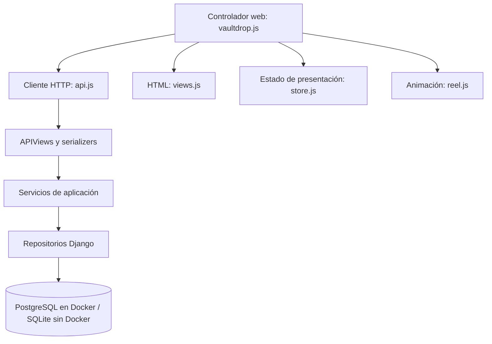

# Arquitectura actual de VaultDrop

## Alcance académico

Este documento describe el código del núcleo Django y sus patrones. La vista completa de despliegue y servicios está en [arquitectura-entrega-2.md](arquitectura-entrega-2.md).

El núcleo de VaultDrop es un **monolito modular con capa de servicios y repositorios**. Un proceso Django atiende la web y la API de operaciones. El catálogo de consulta se extrajo a un microservicio Flask con el patrón Strangler, y las notificaciones corren en un worker de Celery. No es una arquitectura hexagonal pura: los servicios usan transacciones Django y los repositorios devuelven modelos ORM.

## Responsabilidades

| Componente | Responsabilidad | No debe hacer |
|---|---|---|
| Vistas HTML / APIViews | Autenticación HTTP, validación de entrada, invocación del caso de uso, respuesta | Decidir premios o modificar saldos directamente |
| Servicios | Registro, acceso, apertura, créditos virtuales, venta y envío simulado | Construir HTML o interpretar respuestas del navegador |
| Repositorios | Consultas ORM, actualización condicional, persistencia | Elegir premios o enviar correos |
| Modelos | Estructura, relaciones y restricciones de datos | Depender del DOM |
| Serializers DRF | Contratos JSON y validación de entrada | Sustituir transacciones o garantizar compatibilidad automáticamente |
| Frontend | Mostrar respuestas, navegación y animación | Inventar premios, créditos o inventario |



### Módulos

- `users`: registro, acceso con usuario o correo, perfil e historial de notificaciones de envío. `UserService` coordina construcción, guardado y billetera inicial. `authentication.py` acepta un correo solo si pertenece a una única cuenta, sin distinguir mayúsculas.
- `wallet`: saldo y libro de transacciones. Solo `WalletService` cambia créditos.
- `cases`: catálogo, probabilidades, imágenes persistidas por objeto y estadísticas del panel administrador.
- `openings`: apertura, caja gratis diaria, inventario, venta y envío simulado individuales o masivos, mejorador, historial y clasificación.
- `core`: composición web, errores compartidos, ejecución idempotente, unidad de trabajo y el reto de pinyin con HanZi Mentor. `account.py` es una composición de lectura para el cliente; serializa datos de varios módulos y no contiene reglas de mutación.

## Patrones del curso

### Builder

`UserBuilder` valida y construye un usuario sin guardarlo; aplica el hash de contraseña. `AperturaCajaBuilder` valida los datos de una apertura y devuelve los argumentos de persistencia. El servicio controla cuándo se guardan y dentro de qué transacción. En este tamaño de proyecto una función podría resolver parte del trabajo, pero los builders tienen una responsabilidad delimitada y permiten estudiar el patrón sin decidir transacciones.

### Factory

`NotificadorFactory` lee `NOTIFICACION_MODE` y crea `NotificadorConsola` (`MOCK`), `NotificadorEmail` con el backend de consola (`SIMULADO`, el de Compose) o `NotificadorEmail` con SMTP (`REAL`). Todas cumplen `INotificador`, definido en `apps/users/notifications.py`. `InventoryService` exige su notificador en el constructor; `apps/openings/composition.py` lo arma con `NotificadorEnCola`, y las pruebas pasan otro. La bienvenida se agenda con `transaction.on_commit(..., robust=True)`: solo se intenta después de guardar la cuenta y la billetera. `NotificadorEnCola` publica la tarea en Redis, y el worker de Celery la envía con hasta 3 reintentos. Si Redis está caído, la operación se completa y ese aviso se pierde. El aviso de envío simulado guarda una `NotificacionEnvio` con el ID de la tarea: si Celery entrega la misma tarea dos veces, el correo no se repite. Ese historial se ve en el panel.

### Unidad de trabajo

`IUnidadDeTrabajo` (`apps/core/unit_of_work.py`) delimita la transacción de un caso de uso. `AperturaCajaService` y `WalletService` la reciben por constructor; la implementación por defecto, `UnidadDeTrabajoDjango`, usa `transaction.atomic()`. Hoy existe una sola implementación: el contrato deja a los servicios sin depender directamente del ORM para confirmar o revertir.

### SOLID aplicado

- **Responsabilidad única:** APIViews adaptan HTTP; los servicios ejecutan casos de uso; la ruleta solo anima un resultado confirmado.
- **Abierto/cerrado:** una implementación alternativa del notificador puede incorporarse sin modificar el registro.
- **Sustitución:** las implementaciones de repositorio deben respetar sus contratos. Las pruebas sustituyen el azar para obtener resultados repetibles.
- **Interfaces pequeñas:** los contratos están separados por módulo y no se creó un repositorio universal.
- **Inversión de dependencias parcial:** servicios aceptan colaboradores por constructor. Sus valores por defecto siguen siendo implementaciones Django; no se afirma independencia total del framework.

## Consistencia y errores

Una apertura guarda débito, transacción, apertura e inventario en una transacción. Si falla una escritura, todo se revierte. El débito usa una actualización SQL condicionada a `saldo >= costo`, y una restricción impide saldos negativos. El saldo anterior del historial se deriva del saldo resultante dentro de la misma transacción.

Las operaciones HTTP de apertura, caja gratis, recarga, venta, envío, acciones masivas y mejora aceptan `Idempotency-Key` (UUID). Una tabla guarda una clave única por usuario, la huella de la operación y su respuesta. Repetir clave y contenido devuelve el resultado previo. Reutilizar la clave con otro contenido devuelve 409. Si no se envía clave se crea una nueva, por compatibilidad: ese cliente no recibe protección frente a sus propios reintentos. El frontend sí envía y conserva la clave cuando hay un fallo de red o respuesta incierta.

Venta, envío y mejora reservan los objetos con `UPDATE ... WHERE estado = DISPONIBLE AND user = usuario_actual`. Solo una operación puede ganar sobre cada objeto. Con varios objetos es todo o nada: si uno no está disponible, la transacción se revierte. Un fallo al acreditar una venta también revierte el cambio de estado. `ENVIADO` significa simulación persistida; no existe transferencia a Steam.

El mejorador calcula la probabilidad en el servidor, como valor entregado sobre valor objetivo, entre 1 % y 80 %. Los objetos entregados pasan a `CONSUMIDO` y, si hay éxito, se crea el objeto objetivo sin apertura de origen. La caja gratis abre sin costo la caja activa más barata; una restricción única por usuario y fecha impide reclamarla dos veces el mismo día en hora de Colombia.

Los errores de aplicación tienen tipos y códigos estables; el adaptador HTTP los convierte a 400, 404 o 409. Una respuesta fallida jamás genera un premio de respaldo en JavaScript. La interfaz bloquea acciones mientras procesa una mutación. Los errores inesperados siguen siendo 500 para no ocultar defectos.

Con Docker se usa PostgreSQL. Sin Docker se usa SQLite, donde una escritura puede esperar o fallar por contención bajo carga. La integridad no equivale a disponibilidad ilimitada.

## Catálogo e imágenes

La regla de que las probabilidades de una caja sumen 100 % vive en `apps/cases/services.py`. La usan el panel, el modelo y la apertura.

La base de datos es la fuente de `imagen_url`. La migración `cases.0003` carga asociaciones existentes desde una instantánea incluida con la migración. La API ya no necesita leer archivos del frontend para decidir imágenes. Los PNG siguen sirviéndose como recursos estáticos.

`python manage.py seed_catalog` crea solo cajas faltantes y no reemplaza precios ni asociaciones existentes. Al arrancar en Docker se usa `--if-empty`, que solo carga el catálogo cuando no hay cajas, para que una caja borrada desde el panel no reaparezca. El catálogo inicial conserva los valores virtuales; Fracture usa el 25% de Nova del seed previo para que las probabilidades sumen 100% (el antiguo fallback JavaScript sumaba 99,5%). No son probabilidades oficiales de CS2.

## Verificación

```powershell
python manage.py check
python manage.py makemigrations --check --dry-run
python manage.py test apps --noinput
node --test tests/frontend.test.mjs
```

Se prueban registro, Builder, Factory, contratos DRF, saldo, idempotencia, aislamiento del inventario, rollback, perfil, catálogo, acciones masivas, mejorador, caja gratis, panel administrador, traducciones y alianza con HanZi Mentor y comportamiento del cliente ante errores.

La prueba `FlujoCriticoTests` en `apps/core/test_architecture.py` encadena registro, acceso por correo, edición del perfil, catálogo, recarga, apertura, venta y envío simulado con credenciales reales de la API. Comprueba el saldo final, el correo generado en consola y el registro visible en el panel. Ejecuta Celery en modo eager con SQLite. Las pruebas de contrato de ese archivo cubren también repetición de peticiones, aislamiento de usuarios y reversión ante fallos. Las pruebas de navegador de la auditoría de UI/UX están descritas en [auditoria-ui-ux.md](auditoria-ui-ux.md). Las pruebas no sustituyen una evaluación de carga o un despliegue real.

## Límites pendientes

No hay integración con Steam. No hay paginación del resumen de cuenta ni política de limpieza de claves idempotentes; conviene definirlas cuando el volumen lo requiera. El resumen de cuenta agrega varias consultas y no promete una instantánea contable aislada frente a todas las operaciones concurrentes. Las dependencias exactas están en `requirements.lock.txt`.

## Referencias técnicas

- Transacciones y callbacks: https://docs.djangoproject.com/en/6.1/topics/db/transactions/
- Actualizaciones ORM: https://docs.djangoproject.com/en/6.1/ref/models/querysets/
- Contratos y validación: https://www.django-rest-framework.org/api-guide/serializers/
