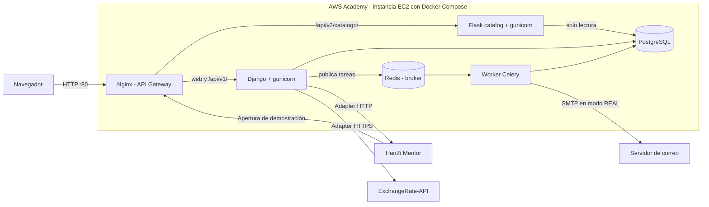

# Arquitectura de la Entrega 2

VaultDrop es un ecosistema híbrido: un núcleo Django, un microservicio Flask extraído con el patrón Strangler, Nginx como API Gateway y un worker de Celery para procesos de fondo. Todo se orquesta con Docker Compose para desplegarse en una instancia EC2 de AWS Academy.

## Despliegue



VaultDrop consulta el catálogo público de HanZi Mentor y genera un reto de pinyin en `/reto-pinyin/`. Configurar `HANZI_CATALOGO_URL` con la URL completa del catálogo publicado, por ejemplo `http://IP_ALIADA/api/v2/caracteres/?nivel=1&limite=20`. Se usa la ruta `v2` porque en el Strangler de HanZi la `v1` es la versión antigua. El navegador habla con VaultDrop y Django consulta HanZi Mentor. Si el servicio falla, la página del reto muestra un mensaje y el catálogo de VaultDrop sigue disponible.

HanZi Mentor puede llamar desde su servidor a `POST /api/v1/cajas/demo/abrir/` sin cuerpo ni autenticación. El servidor sortea un objeto de una caja activa con las probabilidades configuradas. La apertura de demostración no modifica saldos, inventarios ni historiales. Ejemplo de respuesta:

```json
{
  "item": "AK-47 | Redline",
  "rareza": "EPICO",
  "imagen": "http://IP_VAULTDROP/static/core/images/catalog/skin-91a429af4a60.png"
}
```

Los códigos de rareza son `COMUN`, `RARO`, `EPICO` y `LEGENDARIO`. `imagen` es una URL absoluta o `null` si el objeto carece de imagen.

## Responsabilidades

| Componente | Responsabilidad |
|---|---|
| Nginx | Punto de entrada, ruteo por URL y límite de intentos de login y registro |
| Django | Web, autenticación, billetera, aperturas, inventario, panel administrador, migraciones y seed |
| Flask | Consulta pública del catálogo en `/api/v2/catalogo/` |
| PostgreSQL | Persistencia. Flask se conecta en modo solo lectura |
| Redis | Broker de mensajes |
| Worker Celery | Envío de notificaciones con hasta 3 reintentos |

## Patrones

| Patrón | Dónde | Propósito |
|---|---|---|
| Strangler | `services/catalog_service` | Migrar la consulta del catálogo sin detener el monolito |
| API Gateway | `nginx.conf` | Enrutar el tráfico entre Django y Flask |
| Adapter | `apps/wallet/infra/exchange_rates.py` | Aislar la API externa detrás de `IProveedorTasaCambio` |
| Adapter | `apps/core/hanzi.py` | Convertir el catálogo de HanZi Mentor en un reto de pinyin |
| Unidad de trabajo | `apps/core/unit_of_work.py` | Delimitar transacciones sin que los servicios llamen al ORM |
| Factory | `apps/users/infra/factories.py` | Elegir el notificador MOCK, SIMULADO o REAL |
| Builder | `apps/users/domain/builders.py`, `apps/openings/domain/builders.py` | Validar y construir objetos sin guardarlos |
| Repository | `apps/*/repositories.py` | Separar el acceso a datos de los casos de uso |

## Panel administrador

El panel en `/admin/` usa el admin de Django. Permite gestionar cajas y objetos, activar o desactivar cajas y cuentas, y ver aperturas, ingresos, valor entregado y la probabilidad real frente a la configurada.

- Las probabilidades de una caja deben sumar 100.
- Una caja con aperturas no se puede borrar; se desactiva.
- Saldos, movimientos, aperturas e inventario son de solo lectura.
- Las cuentas no se crean ni se borran desde el panel.
- El valor entregado usa el valor actual de cada objeto, porque el valor histórico no se guarda.

## Funciones de inventario

- **Selección múltiple:** vende o envía varios objetos en una sola transacción; si uno falla, no cambia ninguno.
- **Mejorador:** entrega hasta 6 objetos por un objeto de mayor valor. La probabilidad es el valor entregado sobre el valor objetivo, con un máximo de 80 %. El servidor decide el resultado.
- **Caja gratis diaria:** abre sin costo la caja activa más barata, una vez por día en hora de Colombia.
- **Historial y clasificación:** cada usuario ve sus últimas aperturas y mejoras; la portada muestra los 10 mejores premios con el nombre de usuario.

## Resiliencia

Comportamiento comprobado en Docker Compose:

| Falla | Resultado |
|---|---|
| Flask caído | El frontend lee el catálogo de Django; saldo e inventario siguen disponibles |
| Redis caído | La operación se completa; ese aviso se pierde y queda en los logs |
| API de tasas caída | Responde 503 controlado; la billetera funciona sin la referencia en COP |
| PostgreSQL caído | Errores 500 controlados; todo se recupera al volver |
| Catálogo de traducciones no carga | La interfaz funciona con su texto original |

El despliegue en AWS sigue los pasos de [docker-local.md](docker-local.md) y aún debe verificarse en la instancia.

## Internacionalización

La interfaz está en español e inglés con gettext. Los catálogos están en `locale/` y `services/catalog_service/locale/`. El idioma se toma de la cookie o del navegador.
