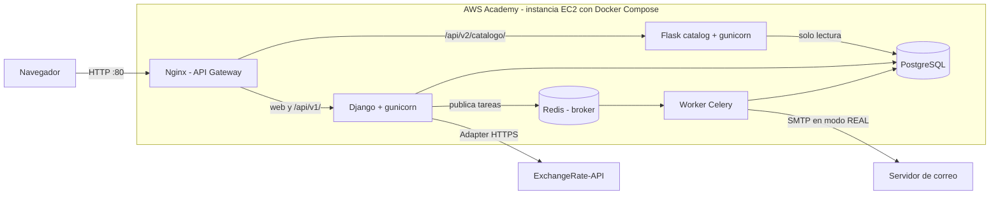

# Arquitectura de la Entrega 2

VaultDrop es un ecosistema híbrido: un núcleo Django, un microservicio Flask extraído con el patrón Strangler, Nginx como API Gateway y un worker de Celery para procesos de fondo. Todo se orquesta con Docker Compose para desplegarse en una instancia EC2 de AWS Academy.

## Despliegue

El consumo del servicio del equipo aliado está pendiente, y su diagrama se completará al integrarlo.

## Responsabilidades

| Componente | Responsabilidad |
|---|---|
| Nginx | Punto de entrada, ruteo por URL y límite de intentos de login y registro |
| Django | Web, autenticación, billetera, aperturas, inventario, migraciones y seed |
| Flask | Consulta pública del catálogo en `/api/v2/catalogo/` |
| PostgreSQL | Persistencia. Flask se conecta en modo solo lectura |
| Redis | Broker de mensajes |
| Worker Celery | Envío de notificaciones con hasta 3 reintentos |

## Patrones

| Patrón | Dónde | Propósito |
|---|---|---|
| Strangler | `services/catalog_service` | Migrar la consulta del catálogo sin detener el monolito |
| API Gateway | `nginx.conf` | Enrutar el tráfico entre Django y Flask |
| Adapter | `apps/wallet/infra/exchange_rates.py` | Aislar la API externa detrás de `IProveedorTasaCambio` |
| Factory | `apps/users/infra/factories.py` | Elegir el notificador MOCK o REAL |
| Builder | `apps/users/domain/builders.py`, `apps/openings/domain/builders.py` | Validar y construir objetos sin guardarlos |
| Repository | `apps/*/repositories.py` | Separar el acceso a datos de los casos de uso |

## Resiliencia

Comportamiento comprobado en Docker Compose:

| Falla | Resultado |
|---|---|
| Flask caído | El frontend lee el catálogo de Django; saldo e inventario siguen disponibles |
| Redis caído | La operación se completa; ese aviso se pierde y queda en los logs |
| API de tasas caída | Responde 503 controlado; la billetera funciona sin la referencia en COP |
| PostgreSQL caído | Errores 500 controlados; todo se recupera al volver |
| Catálogo de traducciones no carga | La interfaz funciona con su texto original |

El despliegue en AWS sigue los pasos de [docker-local.md](docker-local.md) y aún debe verificarse en la instancia.

## Internacionalización

La interfaz está en español e inglés con gettext. Los catálogos están en `locale/` y `services/catalog_service/locale/`. El idioma se toma de la cookie o del navegador.
