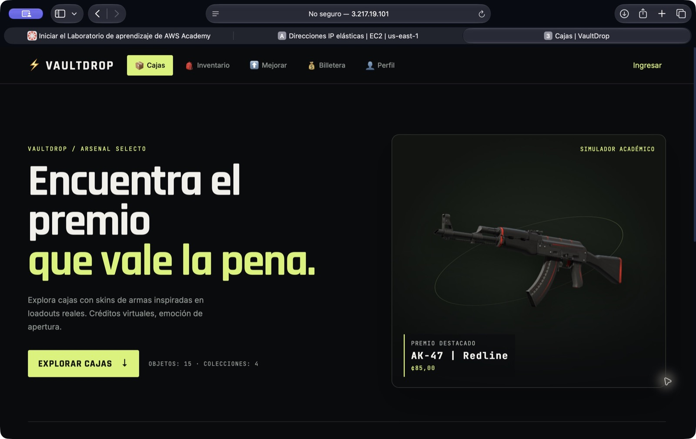
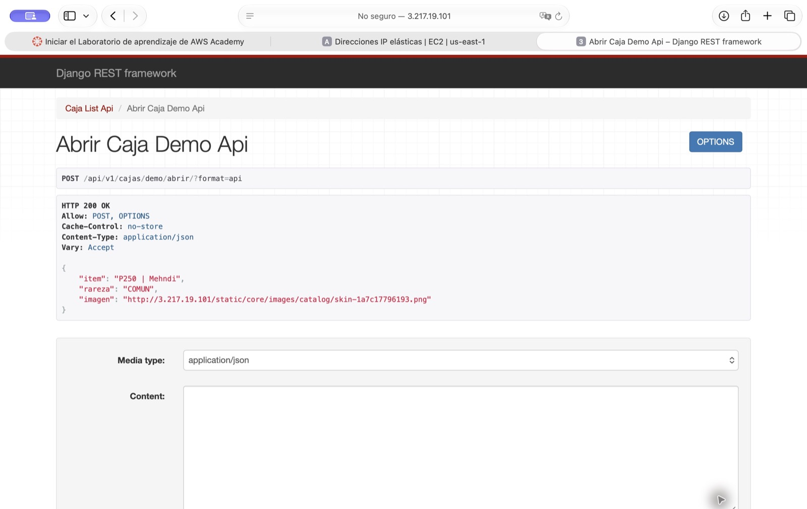
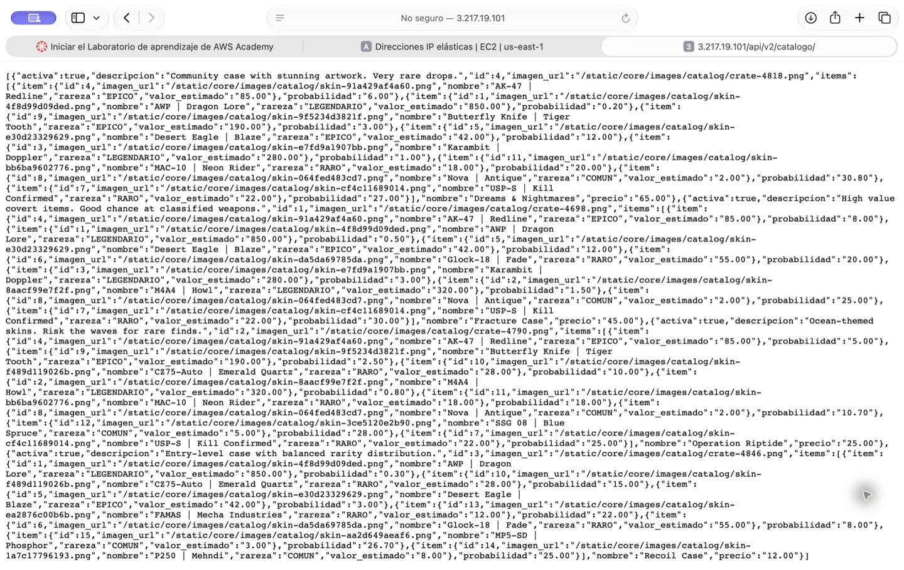
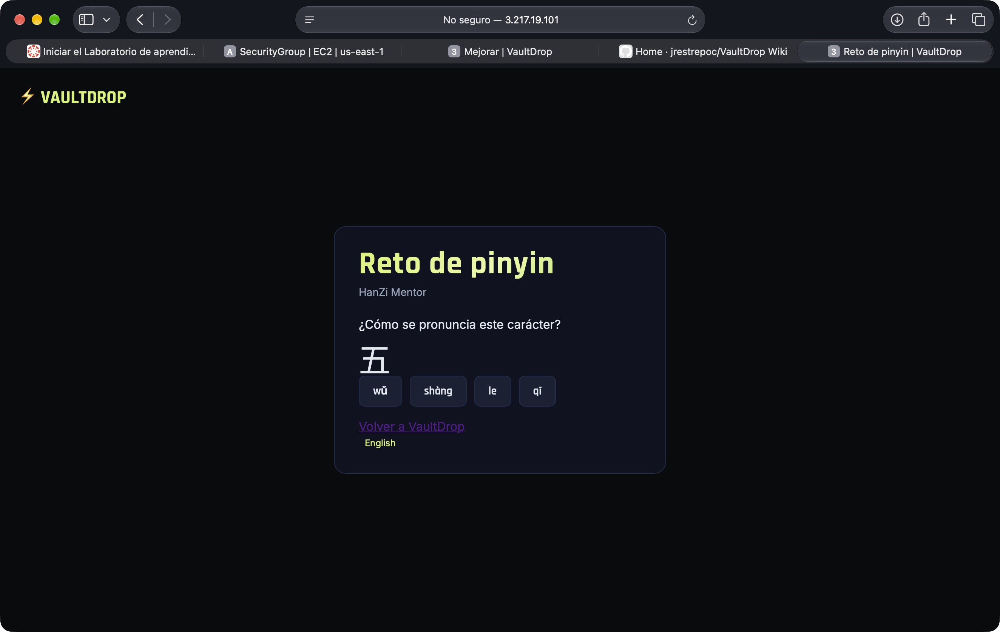
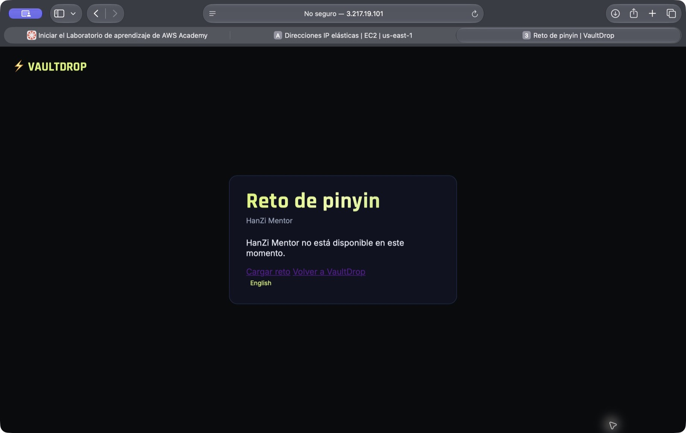

# Evidencia del despliegue de VaultDrop en AWS

VaultDrop se desplegó en EC2 de AWS Academy con Docker Compose. Nginx recibe el tráfico público en el puerto 80 y dirige las solicitudes a Django o al catálogo Flask. PostgreSQL, Redis y el worker Celery forman parte del mismo despliegue.

- [Aplicación en AWS](http://3.217.19.101/)
- [Catálogo público en JSON](http://3.217.19.101/api/v2/catalogo/)
- [Rama main](https://github.com/jrestrepoc/VaultDrop/tree/main)
- [Instrucciones de despliegue](docker-local.md)

## Portada

## Apertura de demostración

La API devolvió el ítem, su rareza y la URL de su imagen. El [PR 52](https://github.com/jrestrepoc/VaultDrop/pull/52) corrigió después la generación de claves de operación para abrir cajas por HTTP. La verificación de esa corrección en EC2 obtuvo HTTP 201 con una cuenta de prueba y confirmó un solo débito virtual al repetir la solicitud.

## Catálogo público

La ruta `GET /api/v2/catalogo/` devuelve las cajas, sus ítems y sus probabilidades sin autenticación.

## Reto de pinyin

La pantalla muestra el aviso de respaldo cuando HanZi Mentor no responde. Con ambas instancias encendidas, HanZi Mentor confirmó que su app muestra las cajas de VaultDrop. VaultDrop cargó el carácter 五 con cuatro opciones y mostró «¡Correcto! wǔ» al elegir su lectura.

