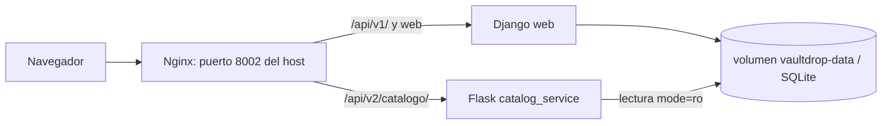

# Migracion a Microservicios (Strangler Pattern)

Este archivo prepara la informacion tecnica para crear la pagina de GitHub Wiki titulada **Migracion a Microservicios (Strangler Pattern)**. No reemplaza la Wiki remota.

## Arquitectura original

VaultDrop era un monolito modular Django con Django REST Framework. Las rutas web, autenticacion, billetera, catalogo, apertura de cajas, inventario y envio simulado se atendian desde el servicio `web`. La base local es SQLite, configurable por `DJANGO_DB_PATH`.

## Matriz de decision

| Modulo | Cambio | Recursos | Acoplamiento | Riesgo de extraccion | Beneficio | Decision |
|---|---|---|---|---|---|---|
| `apps/cases` | Medio: catalogo, imagenes y probabilidades cambian sin coordinar saldos. | Lecturas publicas de cajas e items. | Lo leen aperturas y frontend; no coordina escrituras transaccionales. | Bajo si se extrae solo consulta y Django mantiene la propiedad de datos. | Permite una primera ruta v2 sin tocar credito ni inventario. | Extraido como `catalog_service`. |
| `apps/openings` | Alto: apertura, inventario e idempotencia. | Escrituras con transaccion y seleccion aleatoria. | Depende de `cases`, `wallet`, usuario e inventario. | Alto por consistencia entre debito, apertura e inventario. | Separacion futura de operaciones pesadas, pero requiere diseno transaccional. | No extraido. |
| `apps/wallet` | Alto: saldo y libro de transacciones. | Escrituras sensibles a concurrencia. | Depende de usuario y es usado por apertura y venta. | Alto por propiedad de saldo e invariantes contables. | Futuro candidato si se define contrato fuerte y almacenamiento propio. | No extraido. |

## Funcionalidad seleccionada

Se extrajo el catalogo de cajas porque `apps/cases` ya exponia consultas publicas (`GET /api/v1/cajas/` y `GET /api/v1/cajas/{id}/`) y sus modelos (`Caja`, `Item`, `CajaItem`) son leidos por apertura sin modificar saldos. Las mutaciones de apertura (`POST /api/v1/cajas/{id}/abrir/`) permanecen en Django.

## Arquitectura final



## Responsabilidades

| Componente | Responsabilidad |
|---|---|
| Django `web` | Web, autenticacion, rutas `/api/v1/`, apertura, billetera, inventario, migraciones y seed del catalogo. |
| Flask `catalog` | Rutas `/api/v2/catalogo/` y `/api/v2/catalogo/{id}/`, lectura JSON del catalogo, validacion de parametros y errores estructurados. |
| Nginx | Punto de entrada HTTP y enrutamiento por URL. |
| SQLite en volumen | Persistencia local compartida. Django escribe; Flask abre la base en `mode=ro`. |

## Contratos Flask

### `GET /api/v2/catalogo/`

Lista cajas activas por defecto. Acepta `?activa=true`, `?activa=false` o `?activa=all`.

Respuesta 200:

```json
[
  {
    "id": 1,
    "nombre": "Caja ejemplo",
    "imagen_url": "/static/core/images/catalog/crate-4698.png",
    "descripcion": "",
    "precio": "100.00",
    "activa": true,
    "items": []
  }
]
```

### `GET /api/v2/catalogo/{id}/`

Consulta una caja por id positivo. Devuelve 404 si no existe.

Error estructurado:

```json
{
  "error": {
    "code": "RESOURCE_NOT_FOUND",
    "message": "Caja no encontrada."
  }
}
```

## Estrategia de persistencia y propiedad de datos

Para el alcance del taller se eligio una estrategia hibrida: Django conserva la propiedad del esquema, migraciones, seed y escrituras del catalogo; Flask consulta las mismas tablas SQLite en modo solo lectura (`file:/data/db.sqlite3?mode=ro`). Esto evita duplicar catalogos y evita que dos procesos escriban libremente las mismas tablas. La limitacion principal es que SQLite compartido es adecuado para desarrollo academico, no para alta disponibilidad ni escalado horizontal.

Alternativas evaluadas:

| Alternativa | Resultado |
|---|---|
| Base independiente para Flask | Requeriria sincronizacion o eventos para evitar divergencia del catalogo. Demasiado alcance para el taller. |
| Flask leyendo SQLite en modo lectura | Elegida. Mantiene un solo origen de verdad y minimiza cambios. |
| Migrar catalogo a PostgreSQL o a otro servicio | No necesaria para demostrar Strangler y agregaria infraestructura no pedida. |

## Infraestructura

`compose.yaml` define:

- `web`: Django, volumen `vaultdrop-data:/data`, migraciones y seed no destructivo.
- `catalog`: Flask, contexto `services/catalog_service`, `CATALOG_DB_PATH=/data/db.sqlite3`.
- `nginx`: imagen oficial Nginx, monta `nginx.conf`, publica `127.0.0.1:8002:80`.
- Red interna por defecto de Compose.

`nginx.conf` enruta `/api/v2/catalogo/` a Flask y `/api/v1/` mas el resto de rutas a Django. `proxy_pass` no incluye una URI con barra final, por lo que conserva ruta, query string, metodo y cuerpo.

## Verificaciones ejecutadas

Resultados registrados en esta implementacion:

| Comando | Resultado |
|---|---|
| `python manage.py check` | OK, sin issues. |
| `python manage.py test apps --noinput` | OK, 49 pruebas. |
| `node --test tests/frontend.test.mjs` | OK, 4 pruebas. |
| `python -m unittest discover -s services/catalog_service -p "tests.py"` | OK, 7 pruebas. |
| `docker-compose config` | OK, configuracion valida. |
| `docker compose config` | No disponible en este entorno: Docker CLI no reconoce el subcomando `compose`. |
| `docker-compose up --build -d` | Pendiente: el daemon Docker no esta corriendo (`docker_engine` no existe). |

Comandos para repetir la verificacion:

```powershell
python manage.py check
python manage.py test apps --noinput
node --test tests/frontend.test.mjs
python -m unittest discover -s services/catalog_service -p "tests.py"
docker compose config
docker compose up --build -d
docker compose ps
curl http://127.0.0.1:8002/
curl http://127.0.0.1:8002/api/v1/cajas/
curl http://127.0.0.1:8002/api/v2/catalogo/
curl http://127.0.0.1:8002/api/v2/catalogo/999999/
docker compose down
```

## Limitaciones conocidas

- La ruta v2 es de consulta; las mutaciones siguen en Django.
- Flask no ejecuta migraciones ni seed; depende de que `web` prepare la base.
- SQLite compartido en modo lectura es una etapa academica del Strangler, no un diseno final para carga alta.
